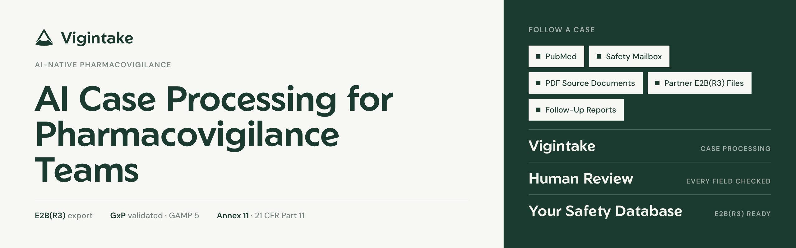

<picture>
  <source media="(prefers-color-scheme: dark)" srcset="./assets/banner-dark.png">
  
</picture>

  <a href="https://vigintake.com"><b>Website</b></a> ·
  <a href="https://vigintake.com/case-processing">Case Processing</a> ·
  <a href="https://vigintake.com/literature-screening">Literature Screening</a> ·
  <a href="https://vigintake.com/news">News &amp; Resources</a> ·
  <a href="https://cal.com/vigintake"><b>Book a Demo ↗</b></a>

Vigintake reads source documents, emails and scientific literature, extracts and codes the case, drafts the narrative in your template and produces an E2B(R3) file for your safety database. Reviewed by your safety scientists, validated for GxP use.

## What Vigintake Does

| Product | What it does |
| --- | --- |
| **Case Processing** | Intake from PDF, email and partner E2B(R3) files. Extraction, MedDRA coding, narrative drafting in your template, E2B(R3) validation and export, with a full audit trail. |
| **Literature Screening** | Nightly PubMed searches and screening for human, veterinary, medical device and cosmetic products, with a documented reason for every decision. |

## In Numbers

| **100+** | **80%** | **4** |
| :-- | :-- | :-- |
| Source languages | Less time drafting narratives | Product domains in literature |

## Works With Your Safety Database

Vigintake sits between your incoming reports and your safety database. Reviewed cases leave as E2B(R3) files for **Argus**, **ARISg**, **Veeva Vault Safety**, **VigiFlow** or any system that imports E2B(R3). No migration.

- **Every value linked to its source.** The reviewer sees the source document next to each extracted field.
- **Human review.** Every field is shown for review and correction before the case is finalised, and each correction is recorded.
- **Validated against EMA business rules** before export.

## Validated for GxP Use

- **Validated system:** URS, functional specification, risk analysis, IQ, OQ and traceability matrix, ready for your PQ. GAMP 5.
- **Complete audit trail:** every edit, status change, coding decision and export is recorded with user, time, previous value and new value, in line with Annex 11 and 21 CFR Part 11.
- **Separated client data:** each organisation is isolated at the database layer. Sign-in through Microsoft or Google single sign-on.
- **Traceable AI output:** the model behind each extraction is stored with the case and included in its structured export.

## Built for the Teams That Process Safety Cases

**PV service providers**, **CROs** and **marketing authorisation holders** use the same system with different set-ups: a narrative template per client, data separated per organisation and an audit trail ready for sponsor audits.

## Get in Touch

- **See it on your own cases:** [book a 30-minute call](https://cal.com/vigintake). Send two or three anonymised source documents and we will show you the extracted case, the MedDRA coding, the narrative and the E2B(R3) file.
- **Sales and general:** [contact@vigintake.com](mailto:contact@vigintake.com)
- **Customer support:** [support@vigintake.com](mailto:support@vigintake.com)
- **Privacy and data protection:** [dpo@vigintake.com](mailto:dpo@vigintake.com)

---

Founded in Barcelona in 2025. Our product repositories are private. Made with care for patient safety.
